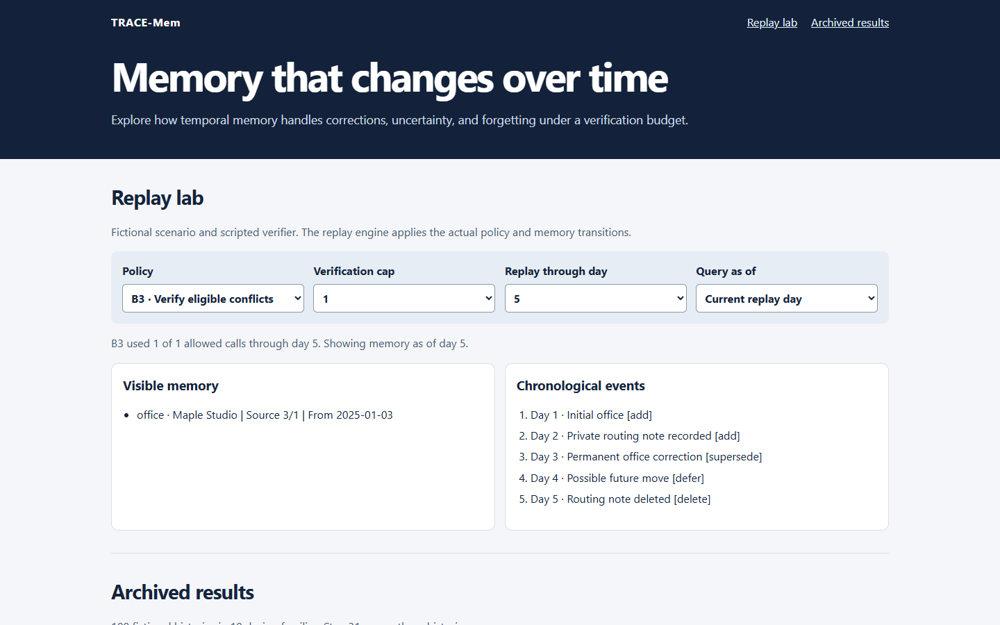
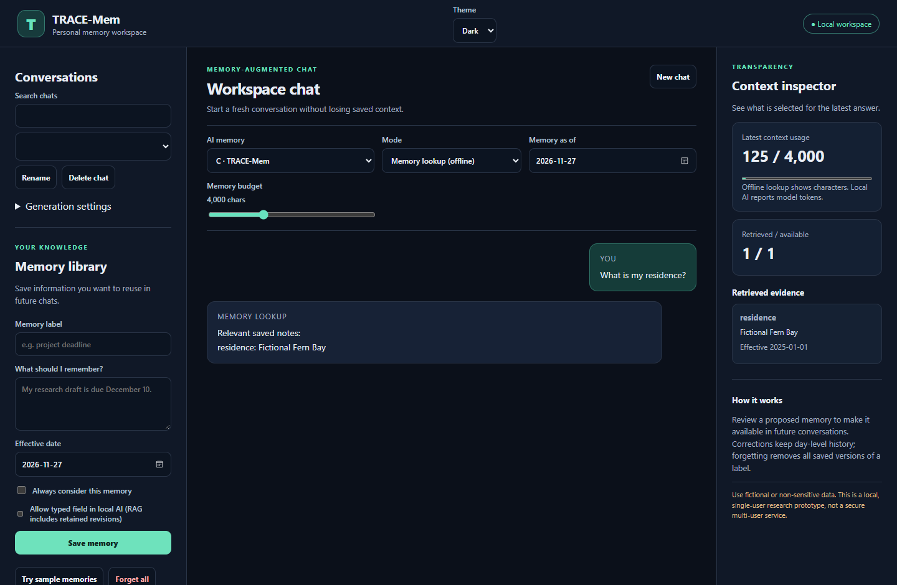
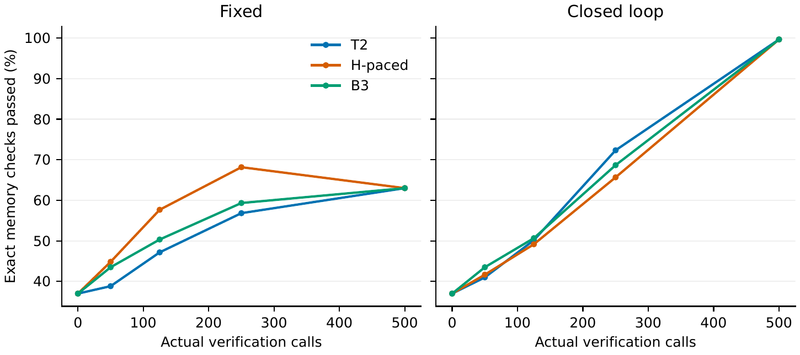
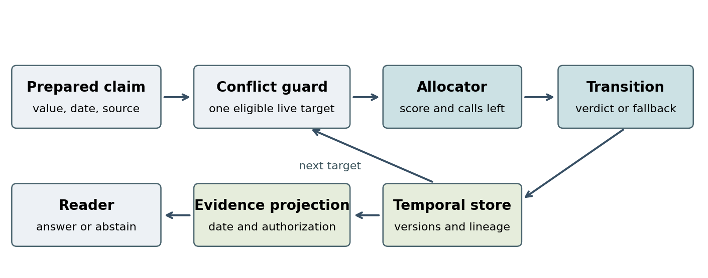

# TRACE-Mem

When should an assistant spend an extra model call to check a memory update? TRACE-Mem combines a temporal fact store, frozen verification controllers and a local conversational Workspace. The research compares policies that can change the very conflicts they will encounter later.

**Research source 1.2.0 · Private Windows research beta 0.42.2**
[Conference paper](research/publication/conference.pdf) · [Full manuscript](research/publication/master.pdf) · [Experimental supplement](research/publication/supplement.pdf) · [Documentation](docs/index.md)

## Try it offline

From an extracted source archive or checkout, run the following with CPython 3.14:

```sh
python -m trace_mem.demo
```

Open the printed loopback address. In **Replay lab**, use B3 with one call, replay through day five, then query day one. The office changes from Maple Studio back to Cedar Hall in the historical view. **Archived results** switches between fixed-stream and chronological replay. The demonstration uses fictional claims and scripted verdicts and requires only the standard library. Stop with Ctrl+C. [Presentation walkthrough](docs/demonstration_guide.md)



## Use Workspace

For a fictional source-mode rehearsal, run the command below. It creates a separate local data file under the ignored results directory. Choose **Memory lookup (offline)** to get started. For conversation generation, run local Ollama with an installed model and refresh the model selector. In the private Windows build, extract the ZIP and choose **Open practice profile** in the launcher. [Installation and troubleshooting](desktop/START%20HERE.txt) · [Profile and privacy boundaries](docs/windows_beta_042.md)

```sh
python -m trace_mem.workspace --data results/practice/memory.json --open-browser
```



## Research result

At **250 verifier calls per arm**, the learned allocator passed **434/600** exact checks against **394/600** for paced heuristic allocation when each controlled its own state. Their ranking reversed on a common conflict stream, **341/600** versus **409/600**. The paired family-bootstrap differences were +6.7 percentage points (95% interval +0.7 to +12.3) and −11.3 points (−16.3 to −6.3). The same 100 internally authored histories in ten families underlie both comparisons. An early-call baseline remained competitive, and state gains did not establish a reader advantage. [Claim-to-evidence matrix](research/final_claim_index.md)



## How it works



The scorer operates on eligible writes. Separate read-time authorization determines which retained facts can support a current or historical answer. Workspace also offers reviewed proposals, corrections, forgetting, local generation and optional semantic retrieval. Its long-history engineering pilot used reviewed facts and direct lookups. The experimentally fitted controls and the application pilot have separate evidence. [Architecture and implementation inventory](docs/architecture.md) · [Application results](research/workspace42/report.md)

## Reproduce, develop and cite

```sh
python reproducibility/reproduce.py --output results/reproduced
python -m scripts.verify_manuscript
```

The numeric release reproduces 230 condition summaries and 184 intervals from 27,000 saved history rows. Independent scientific replication remains future work. For tests, dependencies, figure generation and the local inference prerequisites, see [development instructions](CONTRIBUTING.md) and the [reviewer guide](reproducibility/reviewer-guide.md).

Cite **TRACE-Mem project**, the software version and exact release commit using [CITATION.cff](CITATION.cff). Individual authorship and reuse terms await maintainer confirmation. [Release history](CHANGELOG.md) · [Security and privacy](SECURITY.md) · [Research permissions](docs/ethics_and_permissions.md)
