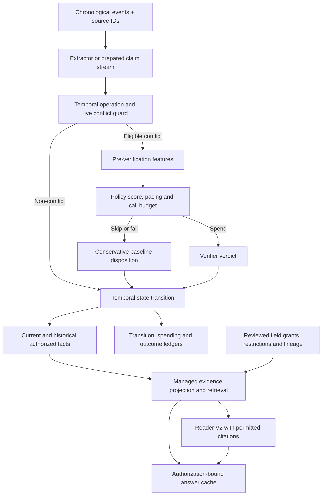

# TRACE-Mem architecture and feature inventory

| Capability | Implemented scope |
| --- | --- |
| Creation, correction, supersession and historical retrieval | Source-linked facts with observed and effective dates and half-open validity intervals. A scoped deletion hides its target from historical and current lookup. Explicit temporary validity and uncertain claims follow temporal rules. |
| Verification policies | B0 empty memory, B1 append baseline, B2 temporal rules, B3 earliest eligible calls, B4 seeded random selection, B5 fixed heuristic, T1 fixed learned threshold, T1-no-NLI, T2 adaptive learned pacing, T2-no-NLI, and H-paced heuristic pacing. Available policies depend on the experiment runner. |
| Replay comparisons | Fixed-stream diagnostics freeze reference candidates and target identity. Online replay selects from live state. A stale fixed target can consume a call without an applied update. Call allowances and actual calls are tracked separately. |
| Managed evidence and reader | Current/historical serving routes authorize evidence by source, field and lineage. Quarantine and cache-generation checks deny stale or ambiguous access. Reader V2 has structured answers, abstention, and citation validation. Reviewed grants are human-assisted. Transcript and source-oracle baselines are isolated diagnostics. |
| Semantic scoring | MiniLM cosine similarity and DeBERTa NLI are pinned in V3. Exact entity and eligible temporal conflict checks precede scoring. No-NLI variants use a separately fitted artifact with that column omitted. |
| Local execution and recovery | Ollama is the pinned local runner for archived experiments. Exact-key caches and versioned checkpoints separate logical calls from physical requests. Step 37 adds a fail-closed preflight for the future independent protocol. |
| Experimental candidates | Contextual, hybrid and segmented extraction and Reader V3 have their own diagnostic runs and failed gates. They have not displaced the frozen benchmark components. |
| Offline console | Fictional prepared claims and scripted verdicts exercise the real temporal engine with B2/B3/B5. Archived comparisons cover additional frozen policies. The console does not accept user histories or call providers. |

## Verification model

T1 ranks an eligible claim-target pair with the logistic score sigmoid(b + sum(w_i × (x_i − mean_i) / scale_i)). Scaling and weights come from training only. The features in order are semantic similarity, contradiction score, exact entity match, temporal conflict, observation gap, provenance, uncertainty and remaining-budget fraction. Provenance measures attributable evidence availability. It does not establish truth. T1 uses the frozen artifact threshold. T2 uses the same learned score with online pacing based on already observed candidates and a planning horizon. H-paced uses heuristic scores with the pacing mechanism. See the [fitted artifact methodology](controller_training.md), [shared V3 builder](../trace_mem/features_v3.py) and [adaptive implementation](../trace_mem/adaptive_verification.py).

An absolute cap is a ceiling on logical verification attempts, including attempts whose result is cached or fails. It is independent of prompt tokens and elapsed time. Exact-quota fixed selection and ceiling-constrained chronological playback are separate estimands.

## Boundaries

The frozen model assumes day-level validity and exact predicate matching for eligible conflicts. Independent production-grade guarantees for same-day replacements, multi-valued predicates, paraphrase-level deletion recall, and complete evidence extraction remain outside the tested scope. Raw benchmark answers and oracle annotations belong only in isolated scoring or explicitly oracle conditions.
