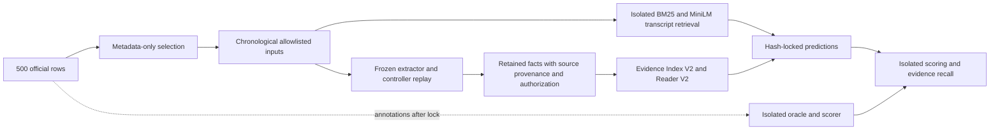

# Step 32 independent LongMemEval diagnostic

This evaluation uses the author-published cleaned LongMemEval_S bundle. It is an exploratory external diagnostic of the frozen TRACE-Mem stack. Previous TRACE-Mem experiments and the Memora held-out boundary were preserved.

## Source and freeze

- Official repository commit `9e0b455f4ef0e2ab8f2e582289761153549043fc`. The MIT license and adjudication script hashes are pinned in the manifest. The benchmark authors' repository identifies the September 2025 cleaned history release. [LongMemEval repository](https://github.com/xiaowu0162/LongMemEval/tree/9e0b455f4ef0e2ab8f2e582289761153549043fc)
- Dataset revision `98d7416c24c778c2fee6e6f3006e7a073259d48f`. The MIT-tagged English JSON contains 500 questions and occupies 277,383,467 bytes. Its SHA-256 matches the publisher's LFS pointer, `d6f21ea9d60a0d56f34a05b609c79c88a451d2ae03597821ea3d5a9678c3a442`. [Cleaned LongMemEval_S download](https://huggingface.co/datasets/xiaowu0162/longmemeval-cleaned/blob/98d7416c24c778c2fee6e6f3006e7a073259d48f/longmemeval_s_cleaned.json)
- Frozen protocol and sample at `9c9c99f`. Seed 32491 selects two from each of the six official nonabstention types, followed by two from the IDs marked with the official abstention suffix. The six strata alternate in two rounds before abstention. Selection uses only IDs and types. The intended sample includes 3,141 pre-cutoff user turns across the 14 full histories. No substitute cases are chosen when a history cannot complete extraction.

## Architecture and isolation



The schema stores aligned session texts, dates, IDs and answer-session IDs. Sessions are filtered against the exact question timestamp before sorting, using the upstream ordinal as the tie-breaker. The model-facing copy contains only the question text, cutoff day, and chronological turns with numeric source ordinals and user or assistant roles. The original session names can encode gold and are never used in model-facing prompts. Answer text, answer-session labels, `has_answer` and question types never enter the blind extractor, rankers, verifier, or reader. TRACE-Mem's internal validity intervals still use dates, so multiple same-day updates may be ineligible even though ingestion order is preserved.

BM25 uses lowercased word tokens, standard length normalization with `k1=1.2` and `b=0.75`, and chronological ties. MiniLM ranks the same turns by cosine similarity. Both roles are indexed. Annotated recall uses the official session IDs and explicitly tagged turns, remapped to ordinal sources. It measures micro recall among answerable questions on the context actually sent to Reader V2 after trimming. Missing or empty gold annotations have no recall denominator. The official implementation also defines retrieval metrics such as NDCG and uses a user-turn index in the cited script. This diagnostic reports its specified post-trimming recall instead. [Official retrieval implementation](https://github.com/xiaowu0162/LongMemEval/blob/9e0b455f4ef0e2ab8f2e582289761153549043fc/src/retrieval/run_retrieval.py)

For the isolated oracle, the official tagged turns form the candidate set, with session fallback when a case has no tagged turns. BM25 ranks this reduced set to fit the shared envelope. Oracle abstention receives empty context. The oracle measures reader limitations under annotated access and its abstention accuracy is partly built into the condition. Transcript diagnostic and oracle access are unrestricted research conditions. Neither grants production authorization.

The unchanged user-turn extractor runs over each complete chronological prefix without manually supplied claims. A failed turn or an interrupted extraction disqualifies that history from managed benchmark scoring. Deletion intent or a possible source restriction triggers conservative history quarantine. Managed replay embeds only retained, currently visible facts whose values occur verbatim, case-insensitively in their originating user turn. Pending, deleted, superseded current, rejected, or source-unverified facts are excluded. This conservative rule can omit valid paraphrases and does not establish general deletion safety.

B1, B2, B3, B5, T1, T2, the paced no-NLI diagnostic and H-paced use identical completed histories. The absolute caps are two and five per history. Paced arms receive a fixed horizon of five as an input before replay. Verifier payloads are restricted to the current claim, current conflict, and current user turn. Raw support annotations and target counts are unavailable. Audit counts on incomplete prefixes are reported as such. Prompt equality and the pinned Qwen digest govern cache reuse. Failed preflight or malformed outputs remain explicit.

Reader V2 uses the same reasoning profile, eight-item maximum and 2,600-byte selection envelope in all arms, with its existing evidence and abstention contract. Actual provider context limits are retained. The scoring stage begins only after blind predictions have been written and hash-locked. The pinned official prompt builder is loaded in isolation and its type-specific rules are used with pinned local Qwen and strict yes/no output. Structured null answers are scored against the official abstention indicator without a judge call. The official script's hosted and 70B judge options differ from this local setup. [Official scoring implementation](https://github.com/xiaowu0162/LongMemEval/blob/9e0b455f4ef0e2ab8f2e582289761153549043fc/src/evaluation/evaluate_qa.py)

Failure-inclusive accuracy includes reader and judge failures in the denominator of completed cases. Scored-only accuracy excludes invalid responses. Incomplete managed cases are separately listed, with no extrapolation from successful histories. Per-history equal realized spending comparisons are descriptive, especially at zero calls. No estimate from this sample supports a confirmatory superiority claim.

## Reproduction

Place the official clone and pinned cleaned JSON at the ignored locations below. Ensure the pinned Ollama Qwen, MiniLM and DeBERTa installations and original V3 outcomes are present. Commands run from the TRACE-Mem root.

```powershell
python -m scripts.longmemeval_inputs data/longmemeval/s.json results/step32
python -m scripts.longmemeval_extract results/step32
python -m scripts.longmemeval_blind results/step32 data/models/nli-deberta-v3-xsmall-a150876 results/updateset-v3-final/outcomes.jsonl
python -m scripts.longmemeval_score results/step32 data/longmemeval/s.json third_party/LongMemEval
python -m scripts.summarize_longmemeval results/step32/safe-report.json docs/step32_artifacts
python -m pytest -q
```

An optional `--retrieval-only` call can checkpoint the blind transcript predictions while extraction runs. It never opens scoring labels. Model-facing copies, raw predictions, extracted facts, caches, and worksheets stay under ignored local paths.
