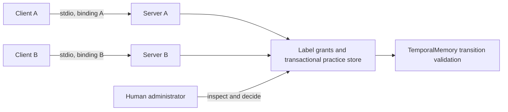

# TRACE-Mem local MCP practice service

Two local clients can share a human-reviewed fictional memory even after their server processes restart. Each client launches a stdio subprocess with its own trusted binding. Both processes open the same dedicated SQLite database. Workspace chats, model-sharing flags, research weights and benchmark data have no import path into this profile.



## Install and initialize on Windows

Run PowerShell from the repository root or the extracted optional MCP source package. The reference host uses x64 CPython 3.14. Install requires access to the Python package index unless the pinned wheels are already cached. Subsequent stdio operation needs no internet connection or model. The independent research demo still uses only the standard library.

```powershell
.\scripts\install_mcp.ps1
$python = (Resolve-Path .\results\step45\venv\Scripts\python.exe).Path
$server = (Resolve-Path .\scripts\serve_mcp.py).Path
$practice = Join-Path $env:LOCALAPPDATA 'TRACE-Mem MCP\Practice'
& $python -m trace_mem.mcp_admin --profile $practice init
& $python -m trace_mem.mcp_admin --profile $practice grant agent-a 'project budget' --read --propose
& $python -m trace_mem.mcp_admin --profile $practice grant agent-b 'project budget' --read --history
$agentA = (Resolve-Path (Join-Path $practice 'bindings\agent-a.json')).Path
$agentB = (Resolve-Path (Join-Path $practice 'bindings\agent-b.json')).Path
```

Initialization creates a new directory and refuses to replace an existing one. On restart reuse the directory and skip initialization. Each grant replaces the prior rights for exactly one agent and label and invalidates its pending proposals. A grant with no flags revokes all rights. It is safe to configure a client before granting rights. For another identity run `bind agent-c` using the same admin prefix and then grant that identity only the required labels. The client launches `$python -I $server --binding $agentA` or the corresponding B binding. A manually launched server waits for MCP messages on stdin.

## Human review

Run these commands in a trusted local terminal. The pending list includes the proposed payload, provenance, effective interval and latest confirmed value. Treat all payloads as data. Choose the specific ticket from the list.

```powershell
& $python -m trace_mem.mcp_admin --profile $practice pending
& $python -m trace_mem.mcp_admin --profile $practice approve TICKET
& $python -m trace_mem.mcp_admin --profile $practice reject TICKET
```

Approve and reject are alternative decisions. Uncertain claims are deferred even after approval. Confirming a resolved uncertainty requires a new reviewed proposal. A conflicting new assertion cannot overwrite an existing slot. A correction must target the current revision and start later within its validity interval. A temporary event uses a separate label and explicit exclusive end date. Once its interval expires, a new nonoverlapping fact can be proposed for that label. Dates have day resolution. Proposal observation is recorded on local receipt; effective dates come from the proposer.

## Tool reference

| Tool | Arguments | Result and boundary |
| --- | --- | --- |
| memory_status | none | Generic readiness; no directory or grant inventory |
| memory_search | query, optional limit | Case-insensitive ASCII substring over authorized current labels or values |
| memory_recall | label, optional as_of | One current fact; earlier dates require the history grant |
| memory_history | label, optional limit | Latest authorized versions, descending by effective date |
| memory_propose | label, value, effective, source, optional kind and expires | Opaque pending ticket for authorized label |
| memory_propose_correction | same fields | Revision-bound proposed replacement |
| memory_propose_forgetting | label, source | Human decision required to forget the entire slot |
| memory_proposal_status | proposal_id | Only owned tickets with current proposal permission; no retained payload |

Unknown fields and invalid dates are rejected. Labels allow up to 64 lower-case ASCII characters, values up to 240 printable characters, and source references up to 64 bounded identifier characters. A read returns at most 12 records. The queue admits at most 256 pending proposals. Empty and unauthorized reads both yield `abstain`. Each evidence item carries its ID, submitting agent, source reference, effective start/end, observed date and kind. IDs and source references never grant access. The injected `untrusted_data` flag labels the tool result for client handling. It cannot force a receiving model to obey that boundary.

## Verification, compatibility and troubleshooting

Optional admin command `advise TICKET --model qwen2.5:7b-instruct-q4_K_M` sends a single eligible, explicit permanent correction and its prior fact to installed loopback Ollama. Invoke it only to authorize this particular local check. It uses the existing conflict guard, direct-v2 verifier, one-call budget and temporary provider ledger. A returned verdict never decides the proposal. Research controller weights remain frozen; the fitted allocator has no validated cross-agent deployment endpoint.

The tested pin is the official Python SDK 1.30.0 with Windows dependency versions recorded in requirements-mcp.txt. The live sessions negotiated the 2025-11-25 protocol. Support for newer protocol revisions was not tested. The transport and tools are compatible with clients supporting this negotiation and structured tool outputs. [Current MCP specification](https://modelcontextprotocol.io/specification/2026-07-28) · [Negotiated stdio specification](https://modelcontextprotocol.io/specification/2025-11-25/basic/transports) · [Official SDK at the tested release](https://github.com/modelcontextprotocol/python-sdk/tree/v1.30.0)

If launch fails, verify all three absolute paths and the selected virtual environment. Check stderr or the host's MCP logs; stdout belongs to JSON-RPC. For an abstention, check the exact label, effective date, separate read/history flags and approval state. For a stale ticket, review current state and request a fresh proposal. Stop an abandoned process before retrying a locked database. Do not replace the database with a Workspace JSON file. To uninstall, remove only this client registration, close its running host and retain or remove the dedicated practice directory according to your retention decision. Remove the optional virtual environment separately. No uninstall step requires changes to Workspace.

[Codex registration](codex.md) · [Claude Desktop and Claude Code](claude_desktop.md) · [Fictional demonstration](cross_agent_demo.md) · [Privacy and trust boundaries](security.md)
