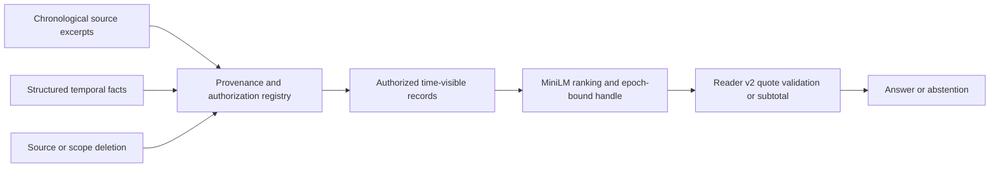

# Step 26 · Reader reliability and deletion-aware evidence

The Step 26 branch starts from the Step 25 review branch, which contained the fetched main at `5dbf815`. Step 25 had not merged at synchronization. Commit `f962aa9` froze the original and revised readers, evidence index, reader questions, safety probes, token settings, and acceptance thresholds before inference. No extractor, T1, or T2 behavior changed.

## Reader v2

Reader v2 uses the pinned local Qwen checkpoint to select exact text and source references. The validator rejects unknown citations, fabricated quote spans, duplicate entries, and malformed supported answers. A model-selected abstention becomes a canonical empty answer and zero citations. A selected quote is rendered within its entire source passage to preserve qualifiers and negation. The drafting profile adds a fixed heading and composes from the passages. This limits open-ended synthesis. A literal match establishes source fidelity, while relevance and semantic adequacy still require evaluation.

The output profiles allow 192 tokens for short answers, 320 for recommendations, 384 for reasoning and 768 for drafting. Both readers retain the 4,096-token context and use the same retrieval ordering, eight-fact limit, and conservative 3,000-byte evidence envelope. Reader v2 sums supported expenses or step counts using decimal arithmetic only for recognizable sum questions. It removes duplicate source references, skips prospective entries, refuses inconsistent same-source values, and labels results as subtotals of retrieved evidence. It cannot certify that retrieval found every event or that two separate reports describe distinct transactions.

## Evidence Index v1

The prototype retains raw excerpts and compatible structured facts under one provenance and authorization registry. Each retained record has a source reference, observation and effective dates, a scope, optional parent lineage, and an optional supersession link. Closed historical visibility accounts for when the replacement was observed. Query-time authorization applies current revocations and scope restrictions regardless of the requested historical date. Linked derivatives inherit restrictions from their parents. Epoch changes invalidate existing retrieval handles and change downstream cache identities. A selected source or scope that cannot be resolved blocks the entire managed index conservatively. The index uses stored references for filtering before scoring, so embedding never receives a denied record during retrieval.



Scope and lineage must be known to tie paraphrased evidence to an original source. Stale handles cannot reauthorize retrieval. Bytes already copied by a client, external caches and detached indexes do not share that guarantee. The diagnostic retains original artifacts locally. This is a synchronous prototype and its tests cannot establish comprehensive deletion safety.

## Frozen comparison

All 15 public development questions use the original Step 24 extraction and Step 25 source nominations. Rubric material remains in a separate scoring process. The retrieval arms are structured B2, isolated transcript retrieval, the managed evidence index, and the deliberately labeled source oracle. The Step 25 transcript and oracle arms retain their prior privacy limitations and are diagnostics only. Both readers receive identical facts within each arm. Unscored failures are reported both separately and as zero in the failure-inclusive average. A shared-question comparison includes only questions valid in every arm for both readers. The benchmark judge is the existing adapted local Qwen implementation with the exact pinned FAMA arithmetic.

```powershell
python -u -m scripts.run_reader_safety third_party/Memora results/memora-step24-final results/memora-step25 results/memora-step26
python -m scripts.summarize_reader_safety third_party/Memora results/memora-step26 results/memora-step25 docs/memora_step26_artifacts
python -m pytest -q
```

## Observed reader and safety validation

| Reader | All cases correct | Answerable correct | Unanswerable correctly abstained | Valid citation contract | Invalid outputs | Unexpected answers on unanswerable cases |
| --- | ---: | ---: | ---: | ---: | ---: | ---: |
| Original | 7/12 | 5/7 | 2/5 | 10/12 | 2/12 | 1/5 |
| V2 | 11/12 | 7/7 | 4/5 | 11/12 | 1/12 | 0/5 |

V2 met the frozen reader gate. The arithmetic path passed both authored subtotal controls. The remaining unanswerable recommendation still failed output validation. The citation metric covers IDs and the abstention contract; it is distinct from a human judgment that all cited evidence is relevant.

The evidence index passed all ten frozen safety assertions, including alternate lineage, stale handles, paraphrased historical queries, observation-aware supersession, and unknown-scope quarantine. The real development history contained **18 unresolved deletion targets**. The index quarantined all 1,154 staged records. No indexed evidence reached either reader. The architecture remains experimental and is not promoted. Synthetic checks establish enforcement on known lineage inside the prototype, while the real run exposes the unresolved authorization bottleneck.

## Observed Memora diagnostic

Each FAMA entry gives **scored-only / failure-inclusive / common-question** macro FAMA. The common set has 11 questions valid in all eight cells. Scoring coverage uses 15 questions per cell. The source nominations are the same unreviewed 79 Step 25 proposals.

| Evidence | Reader | Retrieved nominations | Scored / 15 | Abstained | Invalid | Presence | Forgetting absence | Adapted local FAMA |
| --- | --- | ---: | ---: | ---: | ---: | ---: | ---: | --- |
| Structured B2 | Original | 7/79 | 14 | 13 | 1 | 0/37 | 22/22 | .000 / .000 / .000 |
| Structured B2 | V2 | 7/79 | 14 | 10 | 1 | 0/37 | 22/22 | .000 / .000 / .000 |
| Transcript diagnostic | Original | 47/79 | 15 | 10 | 0 | 6/41 | 22/24 | .099 / .099 / .112 |
| Transcript diagnostic | V2 | 47/79 | 15 | 4 | 0 | 15/41 | 21/24 | .289 / .289 / .258 |
| Evidence Index v1, quarantined | Original | 0/79 | 15 | 15 | 0 | 0/41 | 24/24 | .000 / .000 / .000 |
| Evidence Index v1, quarantined | V2 | 0/79 | 15 | 15 | 0 | 0/41 | 24/24 | .000 / .000 / .000 |
| Source oracle diagnostic | Original | 61/79 | 13 | 6 | 2 | 12/36 | 21/22 | .215 / .186 / .208 |
| Source oracle diagnostic | V2 | 61/79 | 13 | 2 | 2 | 12/35 | 19/20 | .344 / .298 / .407 |

Under identical evidence within each arm, the revised reader improved common-question FAMA with the transcript and oracle. Structured B2 stayed at zero despite returning more nonempty answers. The transcript arm gained nine presence matches but lost one omission match. The oracle arms have different scored question sets and their pooled check denominators differ. The common-question comparison controls coverage. Perfect omission in the quarantined index is a consequence of abstention and measures neither deletion-target resolution nor utility.

Seven revised answers used deterministic subtotals across the three unquarantined arms. The subtotal mechanism cannot infer a complete week from a truncated evidence set. Draft and recommendation failures remain visible in the numbered matrix. Some original-reader terminal outputs differed from Step 25 when retried; valid cached replies were reused and original invalid replies were not imported. Step 25 scores are preserved. There were no judge execution errors. The same-checkpoint local comparator and one development persona constrain interpretation.

## Resources and artifacts

The reader and safety phase used 63 fresh Qwen requests, 40 provider cache hits, 22,017 input and 3,132 output tokens in 202.13 seconds wall time. The rubric-only phase used 94 fresh requests, 128 hits, 15,858 input and 782 output tokens in 60.55 seconds wall time. Across both phases the run used **157 requests**, **37,875 input and 3,914 output tokens**, 238.74 seconds summed provider latency and USD 0. All 108 discovered tests and 36 subtests passed, including pinned upstream tests, with one third-party AnyIO warning.

- [Coverage and failure-inclusive comparison](memora_step26_artifacts/comparison.svg)
- [Memory presence and forgetting components](memora_step26_artifacts/rubric-components.svg)
- [Question-level failure matrix](memora_step26_artifacts/question-failure-matrix.csv)
- [Aggregate results and safety decisions](memora_step26_artifacts/aggregate.json)
