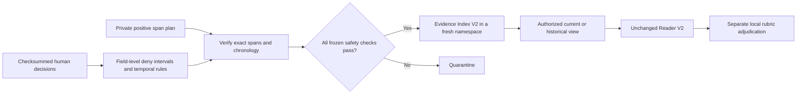

# Step 29 · Authorized evidence recovery

Step 29 starts from merged PR #36 at `31831ca`. Commit `7d31263` froze the positive-span plan hash, annotation checksum, V2 implementation, and adversarial tests before reader inference. The retained annotation file contains 18 explicit human decisions with AI assistance. It was verified against its supplied SHA-256 and the chronological development-user sources. The annotation remains unchanged. The subsequent user grant applies only to verified permitted evidence for local research.

## Architecture and enforcement



The rebuild starts from a private positive allowlist. Inputs must be exact, unique contiguous source spans. For mixed sources it verifies permitted and denied intervals against the same original utterance and applies the union of overlapping restrictions. The source-offset check runs before embedding. Restricted tasks are excluded in full because their active-reminder derivatives cannot be verified. Non-correction deletion-request turns are excluded. Chronological intervals preserve previous travel preferences for historical views and suppress them from current queries. Both extraction errors remain recorded as errors. The associated email purpose was separately verified and listed in the positive plan, which avoids granting a whole document based on its classification.

The index associates each field with its original source reference, a validity interval and an optional parent lineage. Alternate views query the same sealed set. Composed derivatives can only concatenate their authorized parent text, so free-form summaries and unverified paraphrases are not imported. Rebuild changes the namespace, invalidates prior retrieval handles and managed answers, and uses fresh local reader databases and new embeddings. Prior immutable logs and caches remain outside the managed retrieval path. A restriction cannot retract text already exported beyond the system's scope.

## Evaluation protocol

The run verifies all 18 decisions and all targeted source links, exercises historical views and alternate lookups, checks that permitted mixed fields remain available, and tests stale-cache rejection. Any failure prevents reader inference. The V2 run uses the original 15 questions, Reader V2, the same eight-item and 3,000-byte context envelope, and the pinned local Qwen judge. It uses only the weekly development persona. Rubrics are read in the separate scorer. Comparative B2, direct transcript, quarantined V1 and source-oracle rows are archived Step 26 Reader V2 results, bound by the archived scorer hash. No unrestricted replay or held-out evaluation was rerun.

The V2 run is **human-assisted development evaluation**. It measures outcomes after scoped selection and redaction. It does not estimate autonomous deletion resolution. The earlier comparative arms have distinct authorization conditions. Source nomination recall uses the existing Step 25 nominations, not benchmark rubric text.

```powershell
python -u -m scripts.run_authorized_evidence third_party/Memora results/memora-step24-final results/memora-step27/review-annotations-v1.json results/memora-step27/review.json results/memora-step29-grants/span-plan-v1.json results/memora-step29
python -u -m scripts.summarize_authorized_evidence third_party/Memora results/memora-step29 results/memora-step26/scored.json docs/memora_step29_artifacts
python -m pytest -q
```

The positive-span plan, annotation text, predictions, and caches are private local dependencies. The repository contains hashes, implementation, and aggregate results. The original worksheets and experiments were preserved.

## Safety and retention results

The frozen gate passed all **18 individual case checks**, all six additional runtime checks, and three independent adversarial regression tests. The 14 forgetting decisions map to 15 case–source denial links, including the two distinct restrictions on a single attendee source. Among the 57 positive grants, all 57 remained accessible at an eligible date and 54 were current at the benchmark cutoff. Seven permitted fields were recovered from mixed sources. There were zero false deletions among the positive grants and zero denied-span matches in checked embeddings or materialized views. A separate literal review found zero denied-span matches in the 15 generated answers. This is a closed-set check and is not a comprehensive privacy result.

The selection covers 57/1,163 user turns. The other 1,106 raw user turns were excluded, and none of the 88 old structured claim records had validated derivative lineage for import. They remain outside V2. The two corrected preferences retain their explicitly dated historical values; three superseded preference fields are unavailable to current retrieval. V1's archived quarantine withheld all records and therefore retained zero retrievable evidence for the development cutoff.

## Observed Reader V2 results

All conditions use the same pinned local reader settings. V2 authorized is the only newly executed reader condition. FAMA is adapted local arithmetic with the existing Qwen judge. Failure-inclusive FAMA assigns zero to unscored failures. The common-question average uses the 12 questions scored in all five conditions.

| Condition | Retrieved nominations | Scored | Abstentions / invalid | Memory presence | Forgetting absence | FAMA scored / failure-inclusive / common |
| --- | ---: | ---: | ---: | ---: | ---: | --- |
| Structured B2 | 7/79 | 14/15 | 10 / 1 | 0/37 | 22/22 | .000 / .000 / .000 |
| Direct transcript diagnostic | 47/79 | 15/15 | 4 / 0 | 15/41 | 21/24 | .289 / .289 / .257 |
| V1 quarantined | 0/79 | 15/15 | 15 / 0 | 0/41 | 24/24 | .000 / .000 / .000 |
| Source-oracle diagnostic | 61/79 | 13/15 | 2 / 2 | 12/35 | 19/20 | .344 / .298 / .352 |
| V2 authorized, human-assisted | 56/79 | 14/15 | 5 / 1 | 9/37 | 20/20 | .198 / .184 / .106 |

V2 delivered more selected evidence and higher locally judged FAMA than the quarantined V1 condition. It retrieved more nominations than the transcript arm and still scored lower, showing that nomination coverage alone cannot establish answer usefulness. Every reasoning question scored zero in the recovered condition. The curated allowlist limits completeness, several questions require aggregating more than eight sources, and the reader emits scoped subtotals. The omission results use different scored denominators. Evidence access and local scoring do not establish human agreement, generalization, or autonomous deletion resolution.

## Resources and artifacts

- Reader phase used 12 fresh local Qwen requests, 7,807 input and 901 output tokens, with 76.86 seconds summed provider latency and 85.50 seconds wall time. Three questions used deterministic subtotals without a reader request.
- Judge phase used 57 fresh requests, 8,002 input and 474 output tokens, with 50.52 seconds summed provider latency and 51.44 seconds wall time. There were no judge errors. Total spend was USD 0.
- All 115 discovered tests and 36 subtests passed, including upstream tests and one pre-existing AnyIO deprecation warning. T1 and T2, rubric separation, and held-out boundaries were preserved.
- [Aggregate safety and task results](memora_step29_artifacts/aggregate.json) · [Coverage and FAMA](memora_step29_artifacts/comparison.svg) · [Rubric components](memora_step29_artifacts/rubric-components.svg) · [Question matrix](memora_step29_artifacts/question-matrix.csv)
