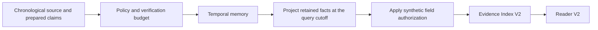

# Step 30 controller reevaluation

This synthetic study tests whether learned allocation improves temporal memory quality at the same verification allowance. It follows the Step 29 human-assisted Memora development study, which remains a separate experiment. The runner does not load Memora personas, questions, or rubrics.

## Frozen design

The protocol and dataset hash were committed before inference in `486e576`. Seed 61843 generates 100 histories in ten new domains with 500 exact-entity, exact-predicate conflicts on a B2 reference stream. Each history includes two true replacements, a misleading correction, an uncertain proposal, an archival mention, a deletion, unrelated material, and two expenses. Source dates, ordering, provenance, and values vary. Ground truth comes from the authored timeline and does not depend on model outputs. Domain families are new, while several underlying update patterns are shared across families and with previous research.

The evaluator uses source-authored candidate claims to control candidate availability. One false correction is intentionally proposed and one real correction is proposed as an assertion. This tests downstream decisions conditional on imperfect claim candidates. Extraction quality, recovery of unstated historical intervals, and open-ended reasoning remain outside the experiment. The historical metric checks initial and four intermediate slots against date-specific gold. The primary memory metric checks the five dates immediately after candidate turns retrospectively and the final state. An exact check requires precisely the expected value, so storing both correct and incorrect values fails.

The budget grid is 0%, 10%, 25%, 50%, and 100% of five nominal candidates per history. Fractional capacity is rotated over the frozen history order, yielding 0, 50, 125, 250, and 500 total allowed calls per verification policy. Fixed-stream methods select their full budget from the same B2 reference stream. A result targeting a stale value still consumes a call and falls back to B2 rather than altering the wrong fact. Closed-loop methods use their own state and can underspend. T2 and H-paced use the declared five-opportunity planning horizon and observe only arrivals seen so far at decision time. That horizon happens to match the constructed dataset; performance under planning errors remains unmeasured. B4 uses five frozen seeds and is averaged within history before aggregation. B3 at 100% is the always-verify reference. The oracle applies independently established update decisions without a verifier.

At 50%, Reader V2 sees only projected policy memory on the first history of each family in both modes. The generative short answer is scored by whether it includes the expected label. A separate subtotal check uses the reader’s deterministic arithmetic, with missing or invalid answers retained in the denominator. This QA sample does not support reliable comparative reader estimates. No local judge or FAMA scoring applies to this synthetic task.

## Evidence integration



There is no transcript fallback. The projection uses retained facts from the policy's temporal state and preserves the fact and source identifiers and validity bounds. Pending, rejected, and deferred facts receive no evidence entry. The independent scenario authorization denies the private field for all query dates, including historical dates. Evidence Index V2 checks visibility again when it materializes a handle. This integration is a synthetic evaluation harness. The Step 29 grant, annotation files, managed human-assisted index, and benchmark experiment remain unchanged. The test gate checks the protected synthetic marker in both the materialized result and the inputs sent to an embedding provider. Its scope is limited to these fixtures and the existing Evidence Index V2 protections.

## Analysis and reproduction

The preregistered primary comparison is T2 minus H-paced at the 50% allowance, separately in each replay mode. The paired percentile bootstrap resamples scenario families 2,000 times with seed 9001. Secondary policy contrasts use the same histories and are exploratory. Intervals are unadjusted and describe uncertainty among ten authored families, with related pattern structure and a shared verifier. Outcome attribution compares each applied verifier decision to the B2 disposition for its then-current target against the independent expected value. This is a per-decision diagnostic and does not estimate an entire counterfactual trajectory.

Use the previously pinned Qwen, MiniLM, and DeBERTa installations and the original V3 candidate-level outcomes. The latter are used only to restore the frozen T2 and H-paced score reference distributions. The runner verifies their established hash, the controller hashes, the local verifier model digest, and the verifier prompt and schema hash. The local result directory contains the request ledgers, response caches, and atomic history checkpoints. Reuse the directory only with the same frozen inputs and runner.

```powershell
python -m scripts.run_step30 results/updateset-v3-final/outcomes.jsonl data/models/nli-deberta-v3-xsmall-a150876 results/step30
python -m scripts.summarize_step30 results/step30/report.json docs/step30_artifacts
python -m pytest -q
```
The measured run used Python 3.14.0, Ollama 0.40.13, CPU PyTorch 2.10.0, Transformers 5.22.2, Tokenizers 0.23.3, NumPy 2.4.2, scikit-learn 1.8.0, and Matplotlib 3.10.8. These are the observed local versions. The general installation files describe a separate pinned environment. Ollama reported a 4,096-token context and 18% CPU / 82% GPU placement on the RTX 2060. For a new run, record the actual local versions alongside the run manifest.

Pacing differs in its score source as well as feature use. T2 uses the frozen learned score with a neutralized budget feature. H-paced uses its existing nonlearned score. They share the pacing mechanism, but the contrast does not isolate learning from NLI availability. The T1/no-NLI comparison addresses the effect of the frozen no-NLI artifact separately. B4 restarts each predefined seed per history. The paired analysis averages the five allocations before resampling families.
