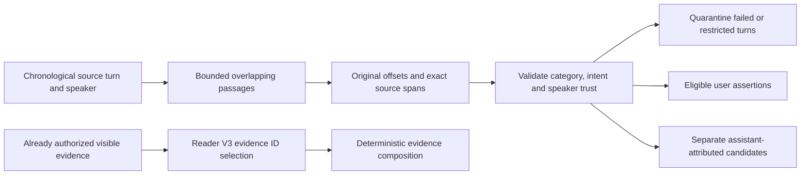

# Step 33 extraction and reader validation

Step 33 preserves the examined LongMemEval diagnostic and isolates component validation on new fictional data. The study started from `4da2877`, the merge of the Step 32 results. The 70 extraction and 30 reader fixtures, implementations, and promotion criteria were committed at `970ced9` before inference. Neither candidate uses benchmark questions, answer annotations, or expected outputs in its design.

## Architecture



Extractor V3 is experimental and separately versioned. Passage boundaries prefer whitespace and retain overlap. A 1,450-byte envelope and absolute character positions preserve source provenance. The observed day and speaker are carried into the provenance record. Prior context can aid selection, but the accepted evidence must be exact, uniquely locatable text in the current passage and contain the exact value. Each occurrence has a source-based identity so dated events and measurements can remain separate. This representation has no automatic write path into the historical memory store. An assistant statement stays assistant-attributed, and eligible user fields are restricted to user assertions and explicit corrections. It does not promote claims about the user based on model confidence.

One bounded recovery request follows a malformed or truncated provider response. Successful empty output is distinct from failure. An unresolved restriction signal, a deletion claim, or a failed passage quarantines the turn, so the projection returns no eligible fields from that turn. Existing deployed deletion tools, authorization grants, and lineage checks remain separate. The new occurrence IDs identify original evidence spans. The experiment does not establish deletion safety for a newly integrated external index or arbitrary derivative paraphrases.

Reader V2 requires the model to reproduce a verbatim quote even though it ultimately returns the complete selected passages. Under the V3 candidate the model proposes only source IDs, and validation rejects unknown IDs, duplicates and inconsistent abstentions. V3 composes the complete selected passages, preserving qualifiers and negation, and retains the existing deterministic subtotal routine. Its scoped synthesis is composition and arithmetic. The model does not produce free-form factual claims. Reader V3 rejects observations after the cutoff and receives only its caller's already authorized evidence.

## Evaluation

The fictional extraction suite repeats seven scenario families across ten instances. It covers long inputs, task and document combinations, assistant proposals and observations, repeated measurements, ambiguous moves, deletion and irrelevant messages. The reader suite covers fact lookup, multiple required facts, negation, missing evidence and an unresolved conflict. Gold facts, intents and exact required citation sets are authored in the fixture source independently of inference. Claim matching uses one-to-one bounded value matching and the correct intent. We report literal support separately so omissions and bad operation inference remain visible. The comparison includes only the tested seven and five scenario families and does not estimate broad performance.

The extractor must reach 95% precision, 80% recall, a ten-point recall gain, 10/10 distinct repeated-event pairs, 10/10 correctly detected restrictions, zero terminal fixture failures and zero assistant trust violations. The reader must reach 85% exact citation-set accuracy, a ten-point accuracy gain, 12/12 correct abstentions and zero terminal invalid results. These predeclared gates protect promotion separately. The external replay requires both gates. The model version, settings, fixtures, candidate sources, and gates are hashed in the local run manifest.

The old extraction failure replay uses identical original requests and a separate cache. The original failed response bodies were not stored, so a replay can isolate recurring problems but cannot recover an original payload. The empty-turn review uses seed 3318 and only conversation text, creating an AI-assisted audit without independent human review. The judge audit uses only the six existing blinded worksheet cases, with the original decisions and worksheet held read-only. A second local model lowers dependence on one judge while leaving disagreements unresolved pending human review.

## Reproduction

Use the pinned local Qwen and Llama installations and the Step 32 ignored outputs. No paid service is involved. All commands run from the repository root.

```powershell
python -m scripts.run_step33 results/step33
python -m scripts.audit_step33 results/step32 results/step33
python -m scripts.step33_secondary_judge results/step32 results/step33 third_party/LongMemEval
python -m scripts.summarize_step33 results/step33 docs/step33_artifacts
python -m pytest -q
```

## Findings

### Step 32 read-only audit

Of the 2,017 processed turns, 124 produced claims, 1,877 were successful empty extractions, and 16 failed. All 16 failures are represented by opaque case and source IDs in the audit artifact. Seven requests exceeded the original 3,840-byte preflight allowance, at 5,841–14,286 bytes including prompt allowance. Exact-input replay reproduced two output-length stops and three schema defects: missing required claim fields, a non-ISO date, and an expiry at or before the start. Four requests originally marked schema failures produced valid output on replay. Their original payloads were unavailable, so the original causes remain unresolved. The audit retained the original failure classes and never changes a formerly failed turn to a pass.

The seeded sample of 24 successful empty turns contained eight plausible omissions, 13 legitimate non-memory turns, and three ambiguous turns. Missed material included preferences, personal goals, dated activities, and numerical details embedded in requests for advice. The sample was assessed once with AI assistance, without human adjudication or extrapolation to the full population. The original user-only extractor cannot directly represent assistant-source observations. In the one scored managed LongMemEval history, an assistant-source question, no policy retrieved the official tagged evidence. The transcript baselines did retrieve it but the reader abstained, separating representation failure from a reader failure on that case.

BM25 and MiniLM each recorded two incorrect abstentions with all tagged turns present. The oracle had three such abstentions. Complete turn recall is an annotation measure and does not independently establish answer sufficiency. The original transcript diagnostics had seven logical invalid reader outcomes. The blind run ledger recorded one distinct invalid model response. Other logical invalids can arise from preflight rejection or reuse. Re-adjudicating six distinct answered outputs from the existing blinded worksheet with pinned local Llama yielded agreement on four of the five Qwen-valid judgments and one disagreement. Llama returned a valid positive judgment for the one Qwen-invalid response. The original scores and the six pending human review cases remain untouched.

### Frozen fictional validation

| Metric | Original extractor | Extractor V3 |
| --- | ---: | ---: |
| Precision under bounded value and intent matching | 100% (22/22) | 100% (50/50) |
| Recall | 22/100 | 50/100 |
| F1 | 0.361 | 0.667 |
| Literal source support | 22/22 | 50/50 |
| Terminal failed cases | 10/70 | 0/70 |
| Exact deletion detection | 0/10 | 10/10 |
| Repeated-event pairs with both facts | 1/10 | 10/10 |

The extractor gained 28 recall points and passed the deletion and trust checks on the frozen fixtures. It recovered all 20 task/document facts and all 20 repeated measurements. It recovered zero of 20 long-input facts, zero of 20 assistant facts and zero of ten uncertain facts. All ten original long inputs failed preflight. Segmentation made their requests complete, but the candidate returned no matching claims. Successful processing alone is therefore a poor proxy for representation coverage. The assistant trust rule held, but actual extraction coverage for that role remains unproven. Source support on emitted claims does not establish correct interpretation of every real request. Extractor V3 **failed the 80% recall gate**.

Reader V2 scored **27/30**, and Reader V3 scored **24/30**. Both answered all lookup and multi-fact fixtures and correctly abstained on all 12 insufficient or conflicting cases. Reader V2 answered three of six negation cases. Reader V3 abstained on all six. Neither produced terminal invalid output or an out-of-context citation. The evidence-ID contract used fewer tokens, but did not improve answer selection. Reader V3 **failed the accuracy and gain gates**.

### Resources and readiness

| Run | Fresh requests | Input tokens | Output tokens | Summed latency |
| --- | ---: | ---: | ---: | ---: |
| Original extractor | 50 | 9,675 | 499 | 69.0 s |
| Extractor V3 | 74 | 18,430 | 2,322 | 173.3 s |
| Reader V2 | 30 | 7,248 | 606 | 35.5 s |
| Reader V3 | 30 | 3,888 | 408 | 24.2 s |
| Step 32 forensic extraction replay | 9 | 2,264 | 1,097 | 69.5 s |
| Step 32 secondary judge | 6 | 1,713 | 12 | 8.7 s |
| Total | 199 | 43,218 | 4,944 | 380.3 s |

The fictional validation took 305 seconds wall time. Extractor V3 had 36 exact cache hits across its 110 passages. Paid spend was USD 0 and the 4,000-request limit was respected. All 131 tests and 36 subtests passed. The aggregate failure matrix and figure regenerated byte-for-byte. Step 32's local files remain in their original locations, and the audit records SHA-256 checks for the preserved predictions, scores, worksheet and extraction report.

TRACE-Mem is **not ready for broader independent evaluation**. Both promotion gates failed, so no new inference ran on the 14 examined LongMemEval histories using either candidate. The larger LongMemEval reserve and held-out Memora stayed outside the experiment. A future promotion gate still needs demonstrated recall on long turns and assistant-attributed sources, reliable handling of negation, and validation of authorization across the full evidence pipeline. The current candidates are useful diagnostics alongside the unchanged deployed components.

- [Results and case-level failure matrices](step33_artifacts/metrics.json)
- [Validation comparison plot](step33_artifacts/validation.png)
