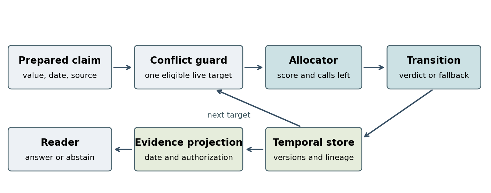
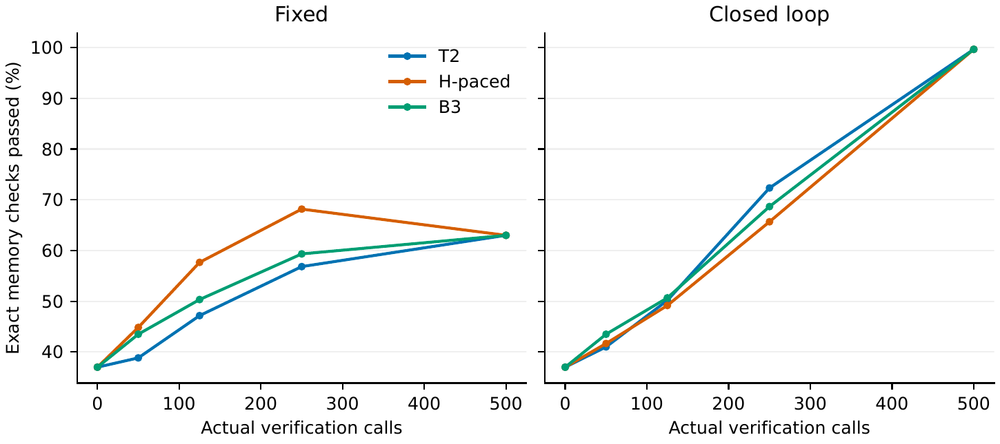
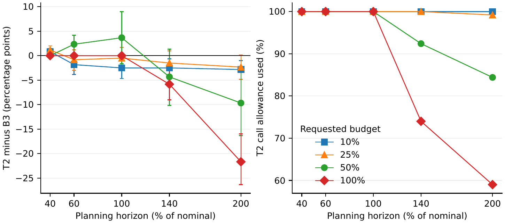

## Abstract

A memory assistant can spend an extra model call to check whether a new statement supersedes a stored fact. Checking one update changes which fact the next statement can contradict. We study how this dependence affects the evaluation of verification policies. Across 100 fictional histories, a learned allocation policy and a paced heuristic each spent 250 verifier calls. When each policy acted on its own evolving memory, the learned policy passed 434 of 600 exact state checks and the heuristic passed 394, a difference of +6.7 percentage points (paired family-bootstrap 95% interval +0.7 to +12.3). When selecting from a common stream of candidate conflicts, the same policies passed 341 and 409 checks, respectively, reversing their ranking. A chronological baseline that checked the earliest conflicts reached 68.7%, and the paired interval for the learned policy’s advantage over this baseline included zero. Overestimating future opportunities further favored the early-call baseline. Reader and external diagnostics showed substantial losses between correct state and correct answers. These findings support evaluating verification policies on their own trajectories and reporting realized expenditure alongside memory quality.

## Introduction

Suppose a user moves from Halifax to Ottawa, then mentions a week in Montréal. The assistant must decide which statements describe residence, which date each describes, and whether it may retain the information. An error at the first move changes the comparison at the next turn. A verifier asked about Montréal versus Halifax faces a different question from one asked about Montréal versus Ottawa. With only one extra call available, the assistant also has to decide whether to spend it now.

This paper asks whether a learned controller makes better use of a scarce verifier than a simple allocation rule. We examine two experimental designs. In one, every policy sees the conflicts identified by a common reference store. In the other, each policy discovers conflicts in the state it has actually produced. The first design controls candidate availability. The second measures the consequences of deploying the policy over a sequence. A ranking that transfers between them would simplify offline evaluation.

The same frozen scores yield opposite rankings under these two designs at identical expenditure. This counterexample matters for developers using a cheap, common candidate pool to select a policy that will control a changing store. We then test how the conclusion changes with a simpler baseline and a misspecified horizon. Finally, we follow the evidence downstream to distinguish a correct memory state from a correct user-facing answer. The latter distinction matters for assistants whose reader can abstain, select the wrong date, or fail to receive a fact in the first place.

## Related work

Temporal memory systems differ in the decision they evaluate. Zep retains temporal graph relationships, while A-MEM organizes notes and evolves their links [@rasmussen2025zep; @xu2025amem]. Mem0 extracts and consolidates salient conversation content [@chhikara2025mem0]. MemFSM distinguishes validity from visibility across a memory lifecycle, and TOKI treats contradiction resolution as a bitemporal write with explicit operators [@zhou2026validity; @wang2026toki]. All provide reasons to model supersession explicitly. Our comparison holds a transition system fixed and varies which competing writes receive extra inference. It supplies no head-to-head performance estimate against those architectures.

FlexA-Mem varies the detail of retrieved memory under a token budget [@xu2026flexamem]. FrugalGPT allocates model expenditure across calls and Adaptive-Consistency varies the number of samples as agreement emerges [@chen2023frugalgpt; @aggarwal2023adaptive]. Chain-of-Verification checks a drafted answer [@dhuliawala2024cove]. Here the scarce unit is one logical check on a write. Spending that unit can change the identity of a later candidate. Memora evaluates remembering alongside forgetting, and LongMemEval distinguishes indexing, retrieval and reading [@uddin2026memora; @wu2025longmemeval]. We use the two external diagnostics to test the limits of conclusions drawn from exact-state accuracy.

## Temporal state and verification

TRACE-Mem associates a claim with an entity, predicate, value, source, and temporal bounds. Observation order determines when the system sees a statement. Effective time determines which value it should return for a particular date. A replacement may end the prior value’s current validity while leaving it available for an authorized historical question. A deletion can also remove its visibility for historical questions. The reader receives only authorized facts projected from retained state. Pending or rejected claims do not supply evidence.

The controlled experiment supplies candidate claims and tests conflicts on an exact entity and predicate match. The base transition rule (B2) processes a candidate without purchasing a verifier call. An allocation policy can spend a call to adjudicate a conflict. B3 spends on the earliest eligible conflicts until its allowance runs out. H-paced uses a hand-designed score to pace expenditure against expected remaining opportunities. T2 uses the same pacing mechanism with a frozen learned score and natural language inference features. The comparison changes both the score source and feature availability. T2’s scoring model was developed on a separate synthetic release of 200 histories in 40 family groups. The labeled training, calibration, and evaluation portions contained 112, 63, and 37 candidate outcomes. Weights remained frozen for the experiments reported here.

In fixed-stream evaluation, each policy selects targets from the common B2 conflict stream. If earlier decisions have superseded a selected target, the call counts against the budget and the transition falls back to B2. This prevents applying a verdict to the wrong fact. In chronological evaluation, candidates are checked against the policy’s own live state at arrival. Each policy may therefore encounter a different set of eligible targets or finish with unspent calls.

### Scoring and allocation

For a live claim–target pair, the ordered feature vector contains MiniLM similarity, DeBERTa contradiction, entity match, overlap with an explicit effective date, observation gap in days, the fraction of direct or dated sources, intent uncertainty, and remaining budget fraction. Intent maps correction, assertion and uncertainty to 0, 0.5 and 1. A scorer can consequently assign different utility to two equally plausible claims if one would already be handled correctly by the base rule.

For feature $j$ let $\mu_j$ and $s_j$ be its training mean and population standard deviation, using unit scale for a constant column. The raw logit $\ell$ and estimated probability of a helpful verification are

$$
z_j=(x_j-\mu_j)/s_j,\qquad
\ell=b+\sum_j w_j z_j,\qquad
\hat p(x)=1/(1+\exp[-(a\ell+c)]).
$$

The binary target comes from paired decisions against the authored outcome. The score estimates the utility of checking within this candidate distribution. It does not estimate the truth of a statement. Training selects the regularization parameter by pooled out-of-fold average precision with balanced classes. A second logistic fit learns the calibration slope and offset on separate families. A nonpositive fitted slope falls back to the identity map. The frozen runtime folds the applied slope and offset into the weights and intercept.

Let $r$ be calls remaining, $H$ the assumed opportunity count and $i$ the one-based count of eligible arrivals, including the present one. Set $h=\max(1,H-i+1)$. T2 scores each pair with the last feature set to one. For $0<r<h$, with $n$ ascending reference scores $u_1,\ldots,u_n$ from training, the cutoff is $u_{\lceil(1-r/h)n\rceil}$. Ties spend in arrival order. Spending is deterministic conditional on the features and budget.

~~~text
For each eligible live pair in chronological order:
    If no calls remain, apply the base transition.
    T1: score the pair at its actual remaining budget fraction.
        Spend if the score reaches the frozen threshold.
    T2: score the pair at budget coordinate one.
        Spend if r >= h or the score reaches the reference cutoff.
    On spending, charge one call and apply the targeted verdict.
    Otherwise apply the base transition; continue from the new state.
~~~

### What constitutes an eligible target?

Write $V(S,e,k,d)$ for visible records in state $S$ for entity $e$ and field $k$ valid on date $d$, with half-open validity intervals. For a nondeletion claim $c_t$ form $D_t=\{f\in V(S_{t-1},e,k,d_t):\mathrm{fold}(f.value)\ne\mathrm{fold}(c_t.value)\}$. A verification target exists only when $D_t$ has one member and its validity starts strictly before $d_t$. Upon supersession the old interval ends at $d_t$ and the new one begins there. A scoped deletion removes access for prior dates too. Pending evidence cannot answer a historical query.

In closed loop, $S_t=T(S_{t-1},c_t,v_t)$ uses the policy's live target and the applicable verdict or base disposition. In fixed replay, construct the candidate stream once under B2, rank by descending score with earlier source index breaking ties, and take the allowed top ranks for the learned selectors. Replay the selected targets in source order. A target that has become stale consumes the selected call but cannot update a different record. This design permits ranking the whole reference stream, an information advantage unavailable to the chronological allocator.

### Estimand and uncertainty

For $N$ authored checks, exact-state accuracy is $A=N^{-1}\sum_i \mathbf{1}\{P_i=G_i\}$, where $P_i$ is the set of values projected at the check date and $G_i$ the expected set. A correct value accompanied by an incorrect one fails. For family $f$, compute the within-family mean paired difference $d_f$. Draw $F$ family indices independently with replacement and compute $\Delta^*=F^{-1}\sum_j d_{I_j}$. Report the observed mean and the 2.5th and 97.5th percentiles of 2,000 draws, linearly interpolating adjacent order statistics at index $(B-1)p$ with seed 9001. All ten families are the same size here. Repeated checks within a history never supply independent bootstrap units.

## Experimental design

The primary study used 100 generated histories in ten authored domain families (data seed 61843). Each history contained two genuine replacements, a misleading correction, an uncertain proposal, an archival mention, a deletion, unrelated material, and two expenses. Dates, evidence order, and values varied. Prepared candidates included a false correction and a true correction expressed as an assertion. Supplying candidates controls an upstream source of variation but leaves autonomous extraction outside the primary experiment.

The reference stream contained five conflicts per history. The budget grid allowed 0, 50, 125, 250, or 500 logical verifier calls across the cohort. The prespecified primary comparison was T2 versus H-paced at 250 allowed calls, analyzed separately in each replay design. Both paced policies initially expected five opportunities per history. A logical call records one policy decision to use the verifier, including a call whose result can be reused from cache. It measures expenditure in decisions. Prompt length and fresh compute can still vary.

The primary outcome is exact slot accuracy over six checks per history: the five dates immediately following candidate turns, evaluated retrospectively, and the final state. Retaining the correct value alongside an incorrect value fails an exact check. The timeline supplies the expected values independently of the verifier. Each paired interval resamples the ten family groups 2,000 times (seed 9001), retaining both policies’ outcomes within each draw. The intervals are unadjusted. They describe variation across a small set of related authored families.

The follow-up changed the expected horizon to 2, 3, 5, 7, or 10 while holding the allowance fixed. Its protocol was frozen before the follow-up runs, after the primary cohort had been examined. We treat these results as robustness checks. A separate reader analysis sampled three histories per family and counted invalid, contradictory, and abstained short answers in the denominator.

## Results

**Table 1. Exact temporal-state accuracy at the nominal 50% allowance.** Each cell summarizes 600 checks. Parentheses give logical verifier calls. The primary pair spent the full allowance in both designs.

| Policy | Common conflict stream | Own chronological state |
| --- | ---: | ---: |
| Base transitions (B2) | 37.0% (0) | 37.0% (0) |
| Earliest calls (B3) | 59.3% (250) | 68.7% (250) |
| Paced heuristic | 68.2% (250) | 65.7% (250) |
| Paced learned policy | 56.8% (250) | 72.3% (250) |

**Replay design changes the ranking.** On the common stream T2 passed 341 checks and H-paced passed 409, a difference of −11.3 percentage points (95% interval −16.3 to −6.3). On their own trajectories the totals were 434 and 394, a difference of +6.7 points (+0.7 to +12.3). In fixed replay, 94 selected T2 targets and 70 heuristic targets had become stale. In chronological replay, 122 applied T2 verifications improved the immediate disposition relative to B2, versus 85 for H-paced. These diagnostics are consistent with consequential differences in target selection. Staleness, timing, and state changed together, so their individual causal contributions remain unresolved.

**A simpler competitor narrows the result.** T2 exceeded early-call B3 by 3.7 points at the nominal chronological horizon (95% interval −1.7 to +9.0). B3 led at both the 10% and 25% allowances with equal spending. With 500 calls, B3, H-paced, and T2 each passed 598/600 chronological checks. An oracle applying the authored update decisions passed all 600. At twice the nominal horizon, T2 saved calls for opportunities that never arrived. It spent 211/250 calls and scored 59.0%, while B3 spent 250 and scored 68.7% (difference −9.7 points, interval −16.3 to −3.2). This comparison measures the practical effect of the planning assumption, including its effect on spending.

**State accuracy does not predict reader accuracy on this sample.** On 30 chronological short-answer questions at the nominal horizon, T2 answered 7 correctly, B3 answered 6, and H-paced answered 12. In the earlier ten-history subset even the oracle state yielded only five correct generated short answers, while its deterministic expense subtotal was correct on all ten. Reader failures can therefore persist after update decisions have been resolved. The samples are too small for a stable ranking of readers.

**Resource use.** The primary grid completed in 1,021 seconds on an RTX 2060 system. Across conditions and seeds, 16,489 logical verifier calls required 814 fresh requests after cache reuse. Fresh verification consumed 233,459 input tokens, 9,537 output tokens, and 730.4 seconds of summed request latency. Shared caching reduces the cost of running the grid. These totals cannot be interpreted as the serving latency of one policy.

## From state maintenance to conversational answers

On the Memora benchmark [@uddin2026memora], the full development run on one persona yielded a mean adapted FAMA score of zero in every scored condition. The local judge scored 2,184 of 2,400 rows. The persona and adapted scoring limit comparison with published benchmark results.

An exploratory LongMemEval diagnostic tested whether the controlled results carried through a complete ingestion and answering pipeline. Under the local scoring procedure, a BM25 retrieval baseline answered 3/14 cases correctly, a MiniLM baseline answered 2/14, and an oracle evidence condition answered 6/14. The managed pipeline completed only one of the 14 histories within its run limit. Every arm missed that case. With one paired completed history, this experiment provides no usable estimate of comparative end-to-end advantage. On separate fictional development fixtures, a revised extractor recovered 50 of 100 expected facts versus 22 for its predecessor, below its frozen 80% gate. A revised reader also fell from 27/30 to 24/30. Both failures argue for measuring acquisition and reading separately when evaluating a write policy.

A local Workspace pilot examined a narrower question: once facts have been reviewed, can they still support answers after the original turn drops out of the active prompt? A single fictional trajectory supplied six nested prefixes of approximately 1k to 64k accumulated word-and-punctuation tokens. Three questions were repeated at each length. All modes shared a 4,096-token context setting. Ollama reported a maximum actual prompt of 1,030 tokens. The early factual turn had already been trimmed at the shortest length.

**Table 2. Workspace engineering pilot.** Each mode faced 18 probes comprising 12 date-sensitive residence questions and six two-fact calculations. Retrieval counts pool required and selected evidence items.

| Mode | Exact answers | Retrieval precision | Retrieval recall | Model input / output tokens |
| --- | ---: | ---: | ---: | ---: |
| Recent history only | 0/18 | undefined | 0/24 | 16,002 / 36 |
| Conventional hybrid RAG | 6/18 | 12/24 | 12/24 | 16,794 / 42 |
| TRACE-Mem | 18/18 | 24/30 | 24/24 | 5,718 / 18 |

Both retrieval arms used the same reviewed revisions, authorization, lexical ranking, local MiniLM, and Qwen2.5 7B Instruct model for generated answers. Both answered all six calculations correctly. TRACE-Mem answered the twelve residence questions by deterministic date-authorized lookup. Conventional retrieval abstained on all twelve. The observed gain thus came entirely from the direct temporal lookup route. The pilot made zero verifier calls. The 54 answer paths reused one trajectory and three questions. Accumulated history length varied while the native context window stayed fixed. On four additional paraphrases, lexical retrieval found the expected top result zero times and MiniLM once. These observations establish a working path for a restricted question type. Reusing the same questions and trajectory gives no estimate of population accuracy, of the length where memory first becomes useful, or of the cost of acquiring facts from a full transcript.

## Limitations and implications

The strongest claim concerns the evaluation design. Freezing candidates makes two selectors comparable at the point of ranking. It can also reward a different selector from the one whose decisions maintain a more accurate live state. Reporting both designs exposes that discrepancy. Reporting an early-call baseline further reveals whether a learned policy improves on simply spending while opportunities are present.

Several boundaries constrain interpretation. The study controls claim availability and reuses update archetypes across ten families. Family resampling captures only part of that dependence. Horizon perturbations reuse the original histories. Scores and language-inference features differ together. Call matching does not equalize tokens or energy. The Workspace experiment begins with reviewed evidence, and its nested histories share a single source turn. An independent evaluation would need fresh scenario authors or independently sourced histories, a prespecified comparison with early-call and paced allocation, realistic extraction, and enough completed external trajectories for paired answer scoring. Our current data cannot resolve whether the learned policy improves a deployed assistant.

## Ethics, artifacts, and reproducibility

The primary histories and Workspace trajectory are fictional. Authorization is applied when facts are projected to the reader, including at historical dates. All 28,000 repeated synthetic policy-level privacy checks passed across the primary grid. Repeated checks share scenarios and do not demonstrate comprehensive privacy or resistance to adversarial input. Human-assisted annotations in earlier project development were kept separate from the primary experiment. No participant outcomes are reported here.

The primary protocol and dataset hash were frozen at commit 486e576, the horizon follow-up at b6aa346, and the Workspace fixtures at 6fe317d with measured candidate f93c13b. Raw third-party benchmark answers, private annotations, and model checkpoints are excluded from the numeric release. The public artifact [@tracemem] includes sanitized outcome counts, family identifiers, a manifest, and a standard-library reproduction script. From the reproducibility directory, running “python reproduce.py --output reproduced” recomputes 230 condition summaries and 184 intervals. This checks arithmetic from archived observations. Repeating model inference additionally requires the model versions and local dependencies in the run manifests. AI assistance was used in project development and in drafting this manuscript. The internally authored fixtures and automated analyses have not undergone independent scientific replication.

## Conclusion

At the same 250-call expenditure, replaying a common set of conflicts and maintaining a live temporal store produced opposite rankings of two verification policies. An early-call policy remained competitive, and a longer assumed horizon left useful calls unspent. For conversational memory research, the outcome worth measuring is the sequence from candidate acquisition through state changes to authorized answers. In this study, a gain at one stage was insufficient to establish a gain at the next.
